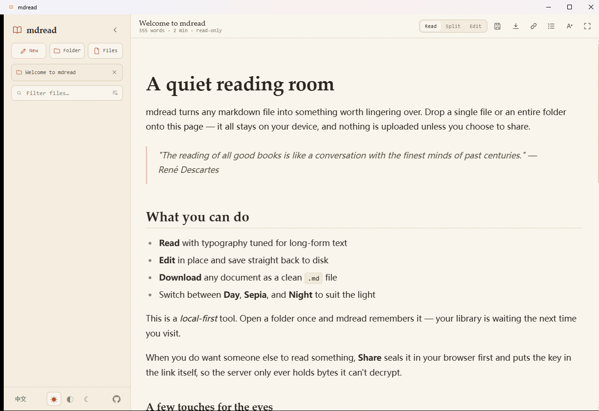

# mdread Desktop

[简体中文](README.zh-CN.md) · **v0.0.6** · Windows x64 portable build

A quiet reading room for Markdown. Open a file or an entire folder, read with a distraction-free layout, edit and save locally, and keep your library on your own device.



## Download

- [Download the Windows x64 portable app](https://github.com/LingBrian/mdread-desktop/releases/download/v0.0.6/mdread-portable-0.0.6.exe)
- [Release notes](https://github.com/LingBrian/mdread-desktop/releases/tag/v0.0.6) · [SHA-256 checksum](https://github.com/LingBrian/mdread-desktop/releases/download/v0.0.6/SHA256SUMS.txt)

This release targets Windows x64. Other operating systems have not been packaged or tested here.

## What it does

- **Open Markdown locally** — choose individual files or recursively load a folder. Drag and drop is also supported.
- **Read comfortably** — adjustable typeface, text size and line width; Day, Sepia and Night themes; table of contents and reading progress.
- **Write and save** — switch between Read, Split and Edit views, save changes to disk, or download a Markdown copy.
- **Navigate larger libraries** — filter filenames, search inside open files, reopen recent folders, and use file actions such as rename, duplicate and delete.
- **Stay local by default** — reading and editing do not upload your files. Local preferences and recent-item metadata are stored on the device.
- **Encrypted sharing and live co-editing** — the client retains the upstream end-to-end encrypted sharing and collaboration flows. The portable app does not bundle a server; server-backed sharing and co-editing require compatible API and WebSocket endpoints. Availability depends on the deployment.

The v0.0.6 desktop client has **no account or vault feature**. Existing data from older versions is not automatically removed; see the [release notes](https://github.com/LingBrian/mdread-desktop/releases/tag/v0.0.6).

## Technology

- **Desktop shell:** Tauri 2, Rust, WebView2
- **Frontend/build:** JavaScript ES modules, Vite 8, Sass
- **Markdown and editing:** Marked, DOMPurify, highlight.js, CodeMirror 6
- **Collaboration:** Yjs and y-codemirror.next
- **Native file access:** Tauri dialog and filesystem plugins

## Build from source

Requirements: Node.js/npm, a Rust toolchain, and (on Windows) Microsoft C++ Build Tools with the Windows SDK. Tauri uses the system WebView2 runtime.

```bash
npm install
npm run test:app
npm run build
npm run portable:build
```

The portable executable is produced at `src-tauri/target/x86_64-pc-windows-msvc/release/mdread-desktop.exe`.

## Upstream project

This desktop application adapts [techjewel/mdread](https://github.com/techjewel/mdread), the original local-first Markdown reader. The upstream project and the derived portions in this repository are distributed under the MIT License; see [`LICENSE`](LICENSE). Third-party dependencies retain their respective licenses.

## License

[MIT License](LICENSE) · Copyright © 2026 techjewel
