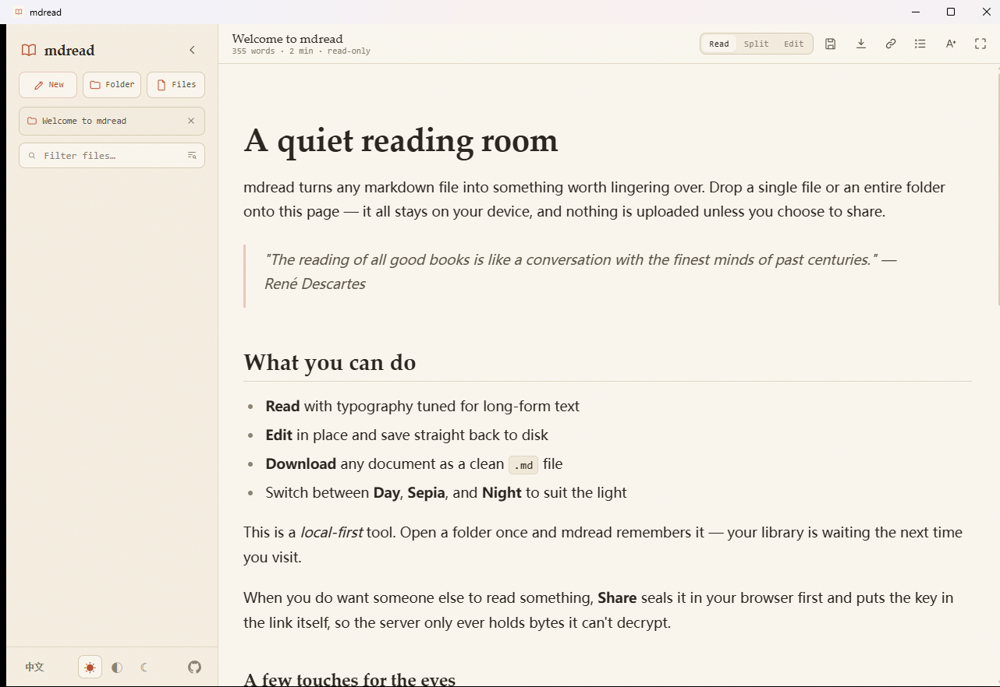

# mdread 桌面版

[English](README.md) · **v0.0.6** · Windows x64 便携版

为 Markdown 打造的安静阅读空间。打开单个文件或整个文件夹，以专注、舒适的排版阅读；也可以直接编辑并保存到本机。



## 下载

- [下载 Windows x64 便携版](https://github.com/LingBrian/mdread-desktop/releases/download/v0.0.6/mdread-portable-0.0.6.exe)
- [版本说明](https://github.com/LingBrian/mdread-desktop/releases/tag/v0.0.6) · [SHA-256 校验值](https://github.com/LingBrian/mdread-desktop/releases/download/v0.0.6/SHA256SUMS.txt)

当前仅提供并验证了 Windows x64 版本；其他操作系统尚未在此处打包或测试。

## 功能简介

- **本地打开 Markdown**：通过文件对话框选择一个或多个文件，也可递归打开文件夹；支持拖放。
- **舒适阅读**：可调字体、字号和行宽；支持日间、羊皮纸和夜间主题、目录及阅读进度。
- **编辑与保存**：在阅读、分栏和编辑模式间切换，将修改保存到磁盘或下载为 Markdown 文件。
- **管理较大的文件库**：按文件名筛选、搜索已打开文件的正文、重新打开最近文件夹，并重命名、复制或删除文件。
- **默认本地优先**：阅读和编辑不会上传文件；偏好设置及最近项目等信息保存在本机。
- **加密分享与实时协作**：客户端保留了上游项目的端到端加密分享和协作流程。便携版不包含服务端；服务器端分享及协作需要可兼容的 API 与 WebSocket 服务，是否可用取决于部署环境。

v0.0.6 桌面客户端**不包含账号或保险库功能**。旧版本留下的数据不会自动清理，详见[版本说明](https://github.com/LingBrian/mdread-desktop/releases/tag/v0.0.6)。

## 技术栈

- **桌面外壳**：Tauri 2、Rust、WebView2
- **前端与构建**：JavaScript ES Modules、Vite 8、Sass
- **Markdown 与编辑器**：Marked、DOMPurify、highlight.js、CodeMirror 6
- **实时协作**：Yjs、y-codemirror.next
- **原生文件访问**：Tauri 对话框和文件系统插件

## 从源码构建

需要 Node.js/npm、Rust 工具链；在 Windows 上还需要 Microsoft C++ Build Tools 和 Windows SDK。Tauri 使用系统的 WebView2 运行时。

```bash
npm install
npm run test:app
npm run build
npm run portable:build
```

便携版可执行文件生成于 `src-tauri/target/x86_64-pc-windows-msvc/release/mdread-desktop.exe`。

## 上游项目

本桌面应用基于 [techjewel/mdread](https://github.com/techjewel/mdread) 改造。上游项目及本仓库中派生的相关代码遵循 MIT 协议，详见 [`LICENSE`](LICENSE)。第三方依赖仍遵循各自的许可证。

## 许可证

[MIT License](LICENSE) · Copyright © 2026 techjewel
